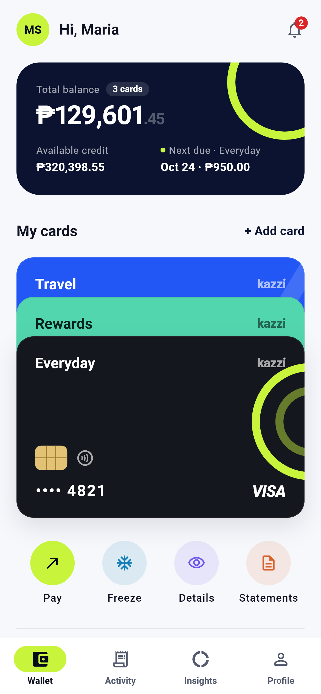
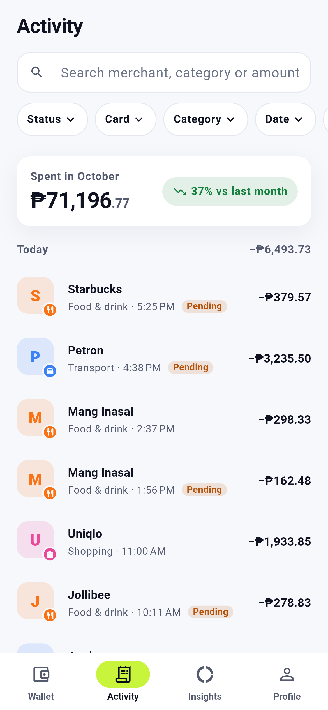
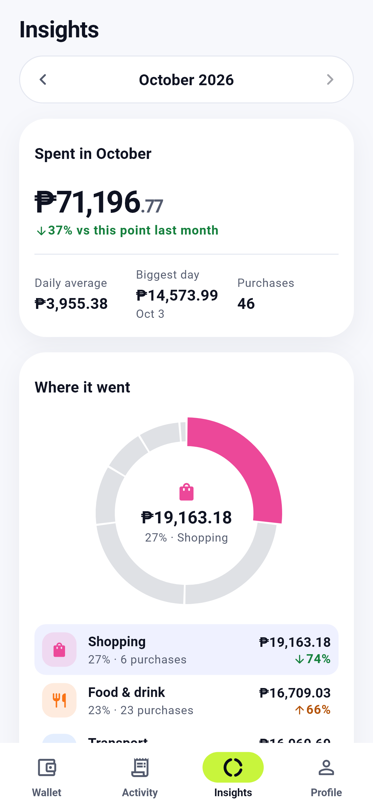
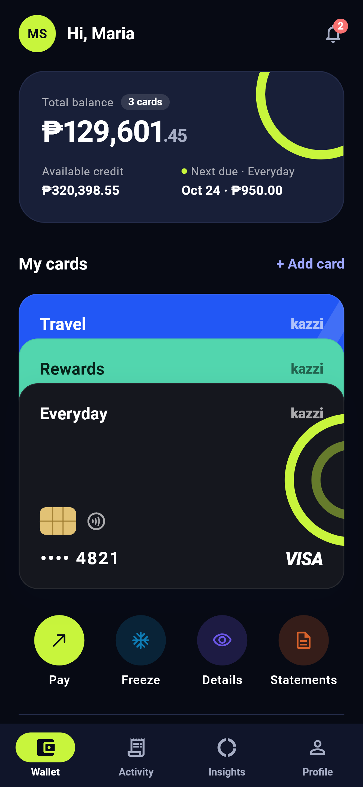
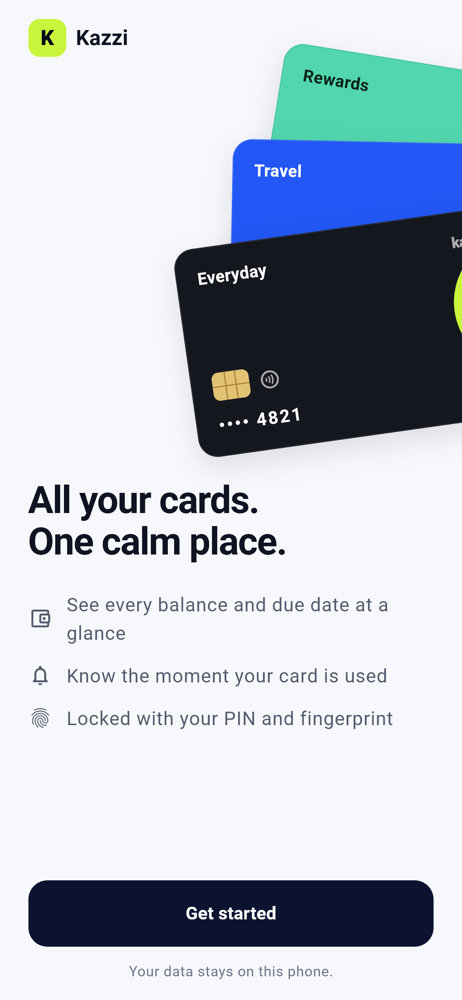
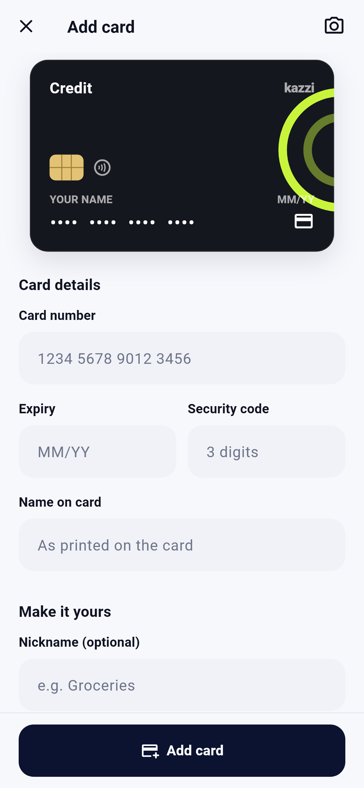
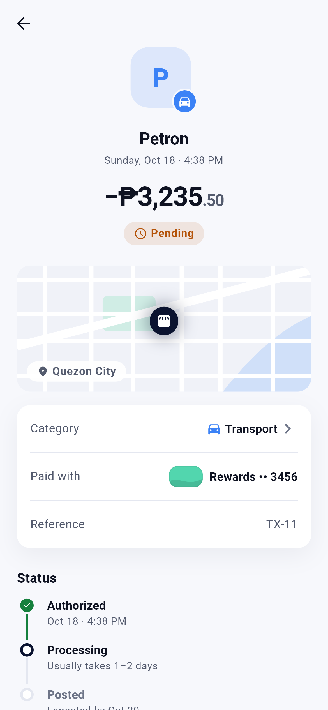
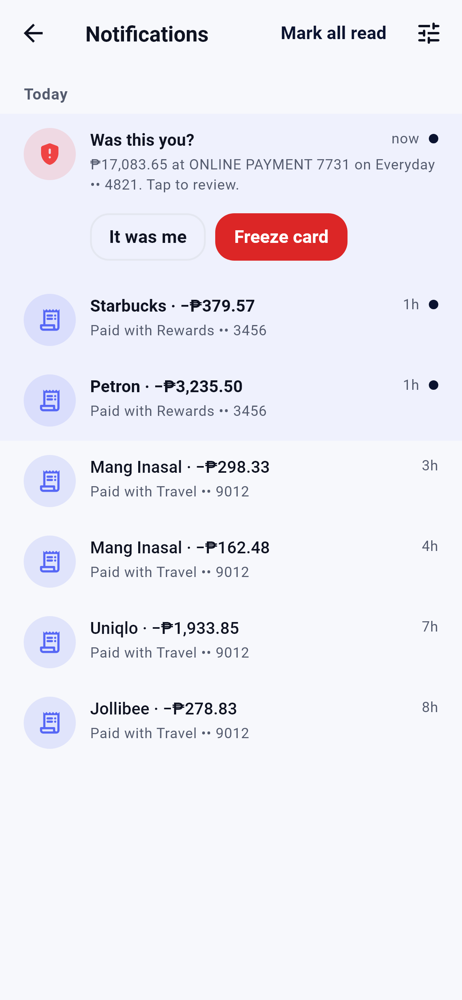
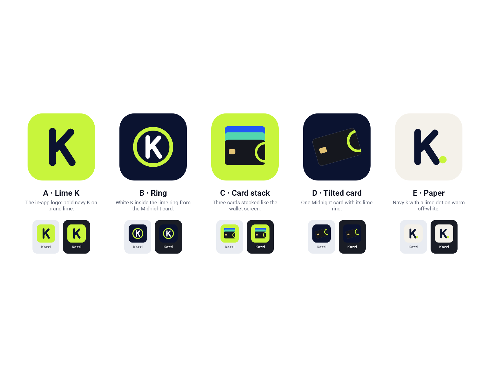

# Kazzi Credit

A credit card wallet for Android and iOS. Keep all your cards in one place, see every purchase as it happens, and know exactly where your money went — in pesos.

Built with Flutter. Everything stays on the phone: card numbers and the PIN live in the OS keystore, and the app ships with realistic demo data so it works without a backend.

<p>
  
  
  
  
</p>

## Run it

```bash
flutter pub get
flutter run
```

```bash
flutter test
```

Requires Flutter 3.47+ (Dart 3.13). Android needs a phone or emulator on API 24+.

To build an APK you can send to someone:

```bash
flutter build apk --release
```

The file lands in `build/app/outputs/flutter-apk/app-release.apk`.

## Features

- **Wallet.** Cards stack like a real wallet — tap a peeking card to bring it forward, tap the front card to flip it. A total-balance summary sits on top; each card shows its balance, available credit and next due date.
- **Card details behind your fingerprint.** "Details" asks for biometrics (or the PIN), shows the full number and CVV for 30 seconds, then hides them. Screenshots are blocked while they're visible.
- **Freeze, pay, undo.** Freezing is instant with an undo toast instead of a confirmation dialog. Paying a bill offers statement balance, current balance or minimum due.
- **Add a card** with a live preview: the number formats as you type (4-4-4-4, or 4-6-5 for Amex), the network is detected from the first digits, typos are caught with the Luhn check, and the card flips over while you enter the CVV.
- **Activity.** Search by merchant, category or amount; filter by card, category, date, amount or status (each filter sheet shows a live result count before you apply it); sticky day headers with daily totals; swipe a row to recategorize it or add a note; pull to refresh and infinite scroll.
- **Transaction detail** with a status timeline, notes, and a "Report a problem" flow.
- **Insights.** Spending by category, weekly totals, top merchants, month-over-month change and category budgets with warnings at 80% and over 100%.
- **Notifications.** Purchase, large-purchase, payment-due, credit-limit, card-frozen and "Was this you?" alerts. Tapping one deep-links to the transaction or card. Quiet hours, a large-purchase threshold, and per-type switches (security alerts can't be turned off).
- **Profile** with your name, +63 mobile and email, appearance (light / dark / match phone) and biometric unlock.
- **Onboarding** in four short steps: welcome, your name, a PIN, then fingerprint and alerts on one screen.

<p>
  
  
  
  
</p>

## The interesting parts

### The PIN is never stored

The 6-digit PIN is hashed with **PBKDF2-HMAC-SHA256** (60,000 rounds, random salt) on a background isolate so the keypad never stutters, and compared in constant time (`lib/features/auth/data/pin_hasher.dart`). A 6-digit PIN only has a million values, so the hash alone wouldn't stop an offline attack — the real protection is that the hash lives in the Android Keystore / iOS Keychain and the app locks the PIN for 30 seconds after five wrong tries. The attempt counter is persisted, so killing the app doesn't reset it, and biometrics can't bypass an active lockout.

Easy PINs (`111111`, `123456`, `654321`, `121212`, …) are rejected at setup.

### Card numbers are kept apart

Card metadata (nickname, last four, balance) and the full number + CVV are stored separately (`card_repository.dart` vs `card_vault.dart`). The full number is only read into memory when you reveal it, held for 30 seconds, and dropped when the timer ends, when you switch cards, or when the app locks. While it's on screen the app sets Android's `FLAG_SECURE` through a small platform channel.

The app also relocks after 30 seconds in the background and blurs itself in the recent-apps switcher.

### Colors that were checked, not guessed

The category donut doesn't give each category its own color. I ran the candidate palettes through a color-vision validator: with seven categories, **43 of the 112 possible "top five" combinations failed** in light mode (orange next to yellow, blue next to violet, pink next to aqua for deuteranopes). So the donut uses emphasis instead: every segment is neutral except the one you select, which is drawn thicker in its category color. Only one hue is ever on screen, and the ranked legend underneath doubles as the table view. Status colors (budgets, due dates, spending deltas) always come with an icon and words, never color alone.

### Money

Every amount is formatted through one place (`lib/core/utils/money_format.dart`) with a real minus sign (−₱1,250.00) and tabular figures in lists so columns line up. Big standalone numbers use proportional figures, which look tighter at display sizes.

### Alerts as pure functions

Which notification a purchase produces — normal, large, or suspicious — and when credit-limit (80% / 100%) and due-date (3 days / 1 day) reminders fire are plain functions with no Flutter in them (`lib/features/notifications/domain/alert_rules.dart`), so they're tested directly. Reminders carry a dedupe key so the same one never fires twice.

### Cards and icon drawn in code

The card faces (flat color plus one printed graphic: rings, bands, a wave, arcs, dots or a slab), the chip, the network marks and the app icon are all painted with `CustomPainter`, so they're sharp at any size and need no image assets. The icon options live in `tool/icon/`:



```bash
flutter test tool/icon/render_icons_test.dart --update-goldens   # render icon PNGs
dart run flutter_launcher_icons                                  # apply to Android + iOS
```

### Accessibility and motion

Minimum 48dp touch targets, semantic labels on custom controls (the PIN pad, cards, chart bars), swipe actions also exposed as screen-reader actions, and layouts that scroll instead of overflowing at 200% text size. With "Remove animations" turned on in the phone settings, animations are skipped — which also caught two layout bugs that only happen with zero-length animations.

## Tests

82 tests across unit and widget tests:

- PIN hashing, attempt counting and lockout
- Auth redirects (onboarding, lock, deep links that survive the lock screen)
- Card network detection, Luhn, number/expiry formatters, validation messages
- Add-card flow end to end, including duplicates and a mistyped number
- Search, filters, day grouping, edits with undo
- Alert rules, quiet hours that wrap past midnight, notification flows and OS-tap deep links
- Insights aggregation: month edges, Monday-start weeks, fair mid-month comparisons

Screens are tested at a phone-sized viewport with reduced motion on. README screenshots are rendered from the real app by `tool/screenshots/`.

## Project layout

```
lib/
  core/             theme tokens, shared widgets, storage, router
  features/
    auth/           PIN, biometrics, lock screen, auto-lock
    onboarding/     welcome, profile, PIN setup, finish
    wallet/         card stack, summary, quick actions, pay sheet
    cards/          card faces, add card, reveal, vault
    transactions/   activity feed, filters, detail, edits
    insights/       aggregation, donut, weekly bars, budgets
    notifications/  alert rules, notification center, settings
    profile/        profile and settings
tool/
  icon/             app icon designs and renderer
  screenshots/      README screenshot renderer
```

State is managed with Riverpod, navigation with go_router, and sensitive data with flutter_secure_storage. The demo data (cards, ~150 transactions from local merchants over 90 days, and live purchases every 30–60 seconds in debug builds) is replaceable by a real backend behind the same providers.
